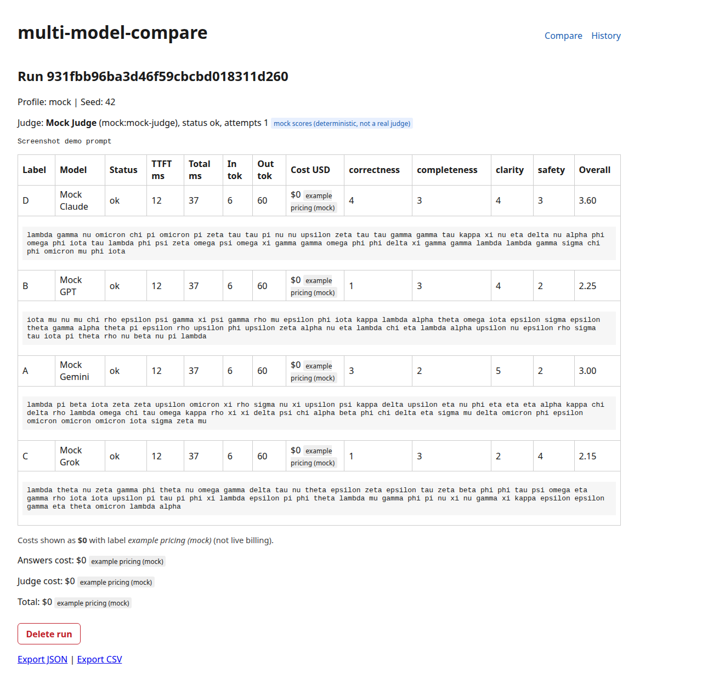
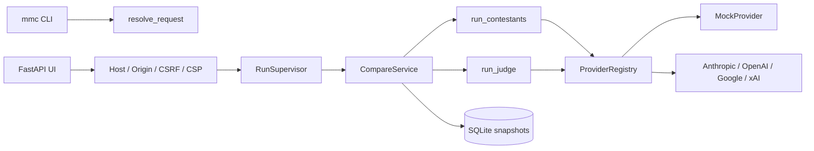
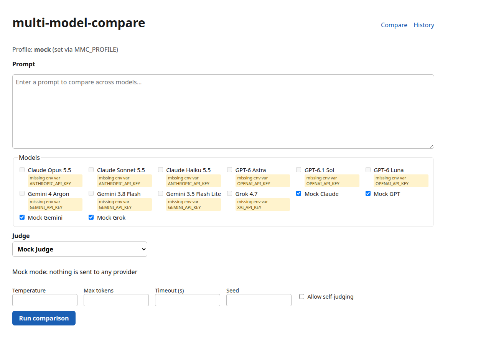
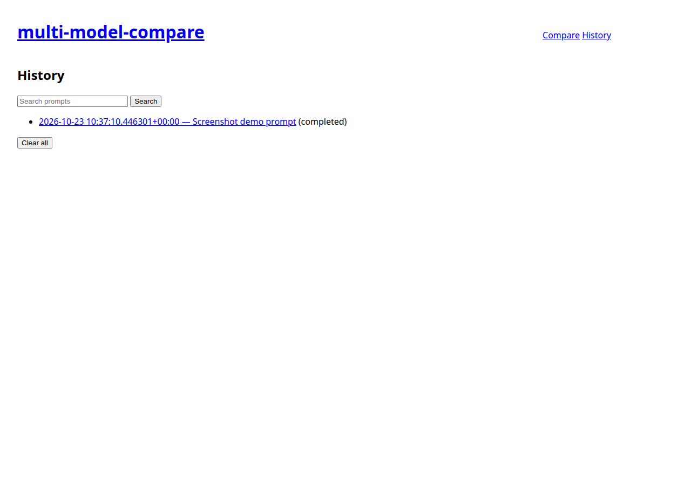

# multi-model-compare

[](https://github.com/applycoding/multi-model-compare/actions/workflows/ci.yml)
MIT · Python 3.13 · [uv](https://docs.astral.sh/uv/)

Open-source **portfolio demo** (MIT) by Arpan Bom ([@applycoding](https://github.com/applycoding)): send one prompt to up to eight LLMs at once, compare answers with cost/latency/tokens, and score them with a structured-output judge. **Mock mode is the default**; no API keys required for development or CI.



## What it does

- Concurrent compare (1-8 models) through a single `Provider` interface (Claude, OpenAI, Gemini, Grok, or deterministic mocks).
- LLM-as-judge with YAML rubric, label shuffling, identity redaction, and native structured output per vendor.
- Honest cost flags (`known` / `estimated` / `unknown`), latency (TTFT + total), and token provenance.
- Versioned SQLite snapshots, history, export (JSON/CSV), and delete/clear.
- Loopback web UI (Jinja2 + vanilla JS) and `mmc` CLI.
- **Default profile `mock`**: CI and quickstart need no secrets.

## Quickstart (mock, no keys)

```bash
git clone https://github.com/applycoding/multi-model-compare && cd multi-model-compare
uv sync
uv run mmc run "Explain CAP theorem in 3 sentences" --seed 1
uv run mmc serve   # http://127.0.0.1:8000
```

## Use real models

```bash
cp .env.example .env
# Fill keys you have, then:
uv run --env-file .env mmc serve
```

Providers without a key are **skipped**. Default live profile contestants use **placeholder** `model_id` values in `models.yaml`; replace them with IDs from vendor docs before calling APIs ([MODEL_IDS.md](docs/MODEL_IDS.md)). Gemini answers are not judged by the default Gemini judge unless `allow_self_judging` is on.

**Docker (local build only):**

```bash
docker build -t mmc .
docker run --env-file .env -e MMC_PROFILE=live -p 127.0.0.1:8000:8000 -v mmc-data:/data mmc
```

## Architecture



### Module map (`src/mmc/`)

| Path | Role |
|------|------|
| `config/` | YAML loaders, models, pricing, rubric schemas |
| `providers/` | Anthropic, OpenAI, Google, xAI, and mock streaming adapters |
| `core/` | Request resolver, runner, pricing, tokens, supervisor |
| `judge/` | Payload, parser, anonymised labels, structured verdict |
| `storage/` | SQLite WAL, immutable `record_json` snapshots |
| `service.py` | CompareService orchestration |
| `export.py` | JSON/CSV export with CSV injection guards |
| `cli.py` | `mmc` subcommands |
| `web/` | FastAPI UI, CSRF, CSP, templates, static assets |
| `disclosure.py` | Mock vs live vendor disclosure strings |

### Mock behaviours (`providers/mock.py`)

`ok`, `stall`, `gate`, `error`, `error_midstream`, `missing_terminal`, `no_usage`, `usage_only_chunks`, `empty`, `reasoning_only`, `refused`, `blocked`, `incomplete`, `judge`, `judge_bad_json_once`, `judge_bad_json_always` (deterministic text from prompt + model id).

In **mock** profile the CLI and UI state: **Mock mode: nothing is sent to any provider** (no live vendor calls).

**Mock costs and judge scores:** dollar amounts are stored and shown as **$0** with the label `example pricing (mock)` in the UI, API (`pricing_disclosure: example_pricing_mock`), and CLI. Mock judge scores are deterministic hashes (`scores_mock: true`); they are labeled as fake in the UI and API, not real evaluations. `pricing.yaml` rates are **illustrative**; verify `source_url` before `MMC_PROFILE=live`. See [docs/MODEL_IDS.md](docs/MODEL_IDS.md) for live `model_id` configuration.

## Configuration

Copy `src/mmc/defaults/` or set `MMC_CONFIG_DIR` to override `models.yaml`, `rubric.yaml`, and `pricing.yaml`.

| Variable | Purpose |
|----------|---------|
| `MMC_PROFILE` | `mock` (default) or `live` |
| `MMC_CONFIG_DIR` | Optional config directory |
| `MMC_DB_PATH` | SQLite path (default `data/mmc.sqlite3`, mode `0600`) |
| `MMC_TOKEN_ESTIMATOR` | `auto`, `tiktoken`, or `chars` (tests use `chars`) |
| `MMC_ALLOWED_HOSTS` | Extra Host allowlist entries (comma-separated) |
| `ANTHROPIC_API_KEY`, `OPENAI_API_KEY`, `GEMINI_API_KEY`, `XAI_API_KEY` | Live providers only |

**Pricing (live profile):** `pricing.yaml` entries are illustrative placeholders with `source_url` and `retrieved_on`; **TODO: verify** against vendor pages before trusting cost output. Grok long-context above 200k tokens uses a separate tier (marked **estimated** when unverified). Haiku uses `basis: from`, which marks the line item **estimated** in the UI (from-price tier note), not an exact list price. xAI reasoning-token billing is **estimated** unless `reasoning_tokens_additive` is verified.

## Judging

Eligible `ok` answers (and `incomplete` when configured) are shuffled to labels A-H, redacted, and sent to the judge as JSON (not delimiter text). The judge uses structured output per provider; temperature 0 where supported (omitted for Claude). Same-vendor answers are excluded unless `allow_self_judging` is on. In mock profile, judge scores are deterministic and flagged `scores_mock`.

**Known limits:** prompt injection and position/style bias are reduced, not eliminated.

## Privacy and retention

The UI and CLI show which vendors receive the prompt before submit. OpenAI requests use `store=False`. Runs live in local SQLite (`0600`); delete via UI or `mmc clear --yes`. Vendor-side retention follows each provider’s policy.

## Security

Keys only in environment variables; prompts containing a configured key are rejected. `Redactor` masks secrets in logs, DB snapshots, UI, and exports. Loopback bind; Docker publish `127.0.0.1:8000:8000` only; Host allowlist, Origin checks, CSRF on mutations, strict CSP.

## Screenshots

| Home | History |
|------|---------|
|  |  |

## Development

```bash
uv run pytest --ignore=tests/e2e -q
uv run playwright install --with-deps chromium
uv run pytest tests/e2e -q
uv run ruff check . && uv run ruff format --check .
uv run mypy src tests
```

Synthetic contract fixtures live under `tests/fixtures/recorded/` (see README there). Maintainer capture: `scripts/record_fixtures.py` (not run in CI). UI screenshots: `uv run python scripts/screenshots.py` after `mmc serve` in mock mode. Regenerate scenario golden: `MMC_UPDATE_GOLDEN=1` locally only.

## CI

Five jobs on `ubuntu-24.04`: gitleaks + ruff, mypy, unit/contract/scenario tests (`pytest --ignore=tests/e2e`), **Playwright e2e** (`pytest tests/e2e` after `playwright install --with-deps chromium`), Docker build + `scripts/smoke.py`. E2e runs on every PR and push to `main`. Actions are pinned by full SHA; `permissions: contents: read`.

## Tutorial

Step-by-step chapters: [`docs/tutorial/`](docs/tutorial/). See also [applycoding.com](https://applycoding.com).

## Limitations

A run in progress is lost if the process dies (no durable queue). See [PLAN.md](PLAN.md) §10 for full out-of-scope list.

## License

MIT © Arpan Bom
